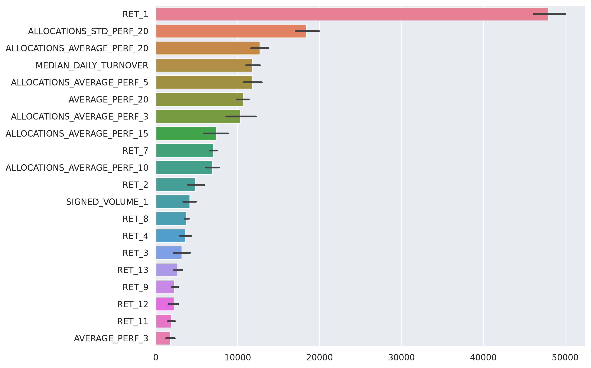

# Asset Allocation Performance Forecasting
## Key Learnings
- OOF modelling
- Out of sample edge
- Leakage control
- Feature Complexity
- Small signal engineering
## Abstract

This study investigates whether the next-session direction of an asset allocation can be predicted from its recent performance, liquidity behaviour, turnover, and allocation identity. Starting from a LightGBM benchmark with more than 40 features, I found that a reduced model using only the previous-session return and median daily turnover achieved a similar competition score of 50.69%, compared with 50.79% for the full benchmark. I then introduced allocation target encoding, rolling performance and volume statistics, Bayesian shrinkage, and bagging-based regularisation. The final model achieved 51.60% on the public leaderboard split and 52.39% using date-grouped out-of-fold predictions, representing a 2.39 percentage-point improvement over 50/50 guessing in the OOF evaluation, or about 1.7 points over an always-predict-positive baseline (50.72% on the training set). Date-block bootstrap resampling gave a 95% interval of 52.11% to 52.66% against 50/50 guessing, while the public-leaderboard result indicates a smaller but still positive 1.60 percentage-point edge over 50/50 guessing (roughly 0.9 points over the always-positive floor, assuming a similar base rate). These results provide evidence of a small, partially generalisable directional signal, but do not establish that the model would produce a profitable trading strategy without further analysis of returns, turnover, transaction costs, and drawdown.

## Introduction
In systematic trading, asset allocations are generated continuously from signals, portfolio rules, and market information. The challenge is not simply producing more candidate allocations, but deciding which ones are likely to perform well in the next trading session. A trader may want to follow a promising allocation, avoid a weak one, or potentially take the opposite position when its expected performance is negative.

Asset allocation is a widely studied field in quantitative research, including at QRT, the host of this competition. Asset allocations are systematic method of collecting assets via given rules and signals. In this challenge in particular each allocation is defined by weights that can be positive or negative, on a specific day, held for a single session from one day to another. These weights are rebalanced every day, rebalanced by the turnover depending on the rules used for the allocation.

In this study I first outline the problem, then the baseline model provided by the challenge, and provide a model that obtains a similar result with minimal features used. After this I apply my ideas and contributions to the model by adding new features and bagging optimisation, then note negative results and other explorations performed. And concluding the study and possible future explorations to be tested.
## Problem Explanation

### Task definition

Each observation represents one asset allocation on one trading day. An allocation is a portfolio constructed from a set of positions with positive or negative weights. It is held for one trading session and may be rebalanced on the following day. The dataset provides the allocation's recent behaviour, including its returns over the previous 20 sessions, signed-volume history, and median daily turnover.

The target is the allocation's return during the following trading session. This project converts that return into a binary classification target:

- `1` if the next-session return is positive
- `0` otherwise

The model therefore answers a directional question: should the allocation be followed, or should its poor expected direction make it a candidate for avoidance or a short position? The evaluation does not reward predicting the size of the return; it only measures whether its sign is predicted correctly.

### Portfolio return

For allocation $S$ on day $t$, let $w_{S,t,i}$ be its weight in asset $i$ and let $r_{i,t+1}$ be the return of asset $i$ during the following session. The realised allocation return is:

$$
r_{S,t+1} = \sum_{i=1}^{M} w_{S,t,i} r_{i,t+1}
$$

The classification target is the sign of $r_{S,t+1}$. Accuracy is defined as:

$$
\mathrm{Accuracy} = \frac{1}{N} \sum_{j=1}^{N} \mathbf{1}\left[\widehat{y}_j = y_j\right]
$$

where $N$ is the number of observations and $\mathbf{1}$ equals one when the prediction is correct and zero otherwise.

### Available information

The main feature groups are:

- 20-day histories of allocation returns (`RET_1` through `RET_20`)
- 20-day histories of signed volume (`SIGNED_VOLUME_1` through `SIGNED_VOLUME_20`)
- median daily turnover
- allocation identity and anonymized allocation group

The dates are anonymized and shuffled, so the labels do not guarantee chronological continuity. However, several allocations can be observed on the same timestamp. This means that the observations are naturally grouped by date and that evaluation must avoid allowing observations from the same date to be split carelessly across training and validation sets.

I also tested whether row order could be treated as time order within an allocation. If it could, `RET_2` in one row should match `RET_1` in the next row of the same allocation; the correlation was about 0.007, and tests at several other offsets were similarly close to zero. No chronology can therefore be recovered from the file, which is why every target-derived feature in this study is built out-of-fold rather than from expanding historical windows.

## Baseline Reproduction and Minimal Model
The challenge provides a benchmark model based on LightGBM and a broad set of historical allocation features. Before introducing new features, I first examined the benchmark to identify which variables were driving its predictions and whether its full feature set was necessary.

### The relevant floor

The training target is positive in about 50.72% of rows, so always predicting "positive" already scores about 50.7%. This, rather than 50%, is the honest floor for this metric. If the test set has a similar base rate, the benchmark (50.79%) and the reduced model below (50.69%) sit only slightly above an always-positive prediction, which is a useful reminder of how thin the signal is.

*Figure 1: Feature importance from the benchmark LightGBM model.*

### Feature reduction experiment

The benchmark uses the 20-day return history, the 20-day signed-volume history, median daily turnover, and additional aggregate features. I began by comparing the historical return and volume variables with the binary target. I then tested smaller models to determine whether removing features caused a meaningful loss in accuracy.

The feature-importance plot shows that `RET_1`, the allocation's return from the previous session, is the strongest input in the benchmark. The sign of `RET_1` alone matched the next-session sign 51.89% of the time, and its Pearson correlation with the target (0.085) was several times larger than that of any other return lag. Median daily turnover matters through how it conditions `RET_1`: the sign-match rate of `RET_1` was 52.09% when turnover was above its median and 51.70% when below. Together, these variables describe recent performance and how quickly the allocation changes its positions, giving the benchmark a short-term momentum and persistence signal. The other return and signed-volume lags have much smaller individual relationships with the target. This does not prove that they contain no information, because weak variables may still help through nonlinear interactions, but it suggests that most of the benchmark's direct signal comes from a small part of the feature set.

One data-quality issue is worth recording. `SIGNED_VOLUME_1` is missing in about 73.5% of training rows (lags 2 to 20 are essentially complete), apparently a structural reporting gap. A naive sign-match check silently counted those rows as errors and reported 13.33%, which looked like a strong signal but was an artifact. Volume was therefore left out of the reduced model, and the volume aggregates used later are computed from lags 2 to 20 only.

I therefore trained a reduced model using only `RET_1` and median daily turnover. On the competition test set, the reduced model achieved an accuracy of `0.5069`, compared with `0.5079` for the full benchmark. The difference was approximately `0.00103`, or `0.10` percentage points. The reduced model therefore reproduced almost all of the benchmark's score while using only two features instead of the full feature set.

This result changes how the benchmark should be interpreted. A large number of input features does not necessarily mean that the model is using a large amount of independent predictive information. For this metric, the extra features added little incremental accuracy beyond recent return and turnover. The reduced model also provides a cleaner baseline for the rest of the study: any later improvement can be attributed to a specific feature idea rather than to an opaque collection of variables. The purpose of this experiment was therefore not only to simplify the benchmark, but to create a controlled starting point for testing allocation information, cross-sectional transformations, and other proposed improvements.

## Novel Contribution

The reduced baseline showed that recent return and turnover contained most of the benchmark's direct signal, but it did not use the fact that the same allocation appears repeatedly across the dataset. I therefore introduced features designed to describe the allocation itself.

### Allocation target encoding

The first expanded model combined the benchmark's rolling return features (rolling averages and volatility of allocation returns, together with their per-timestamp cross-sectional averages) with the allocation identity, used as a predictive feature through target encoding. For each training fold, I calculated the historical positive-return rate of each allocation using only the fold's training observations. This encoded whether an allocation had historically performed better or worse than the overall average, while avoiding the use of validation targets. Unseen allocations were assigned the training-fold global rate.

The motivation was an exploratory finding: across the 278 allocations, the long-run positive-return rate ranged from about 38% to 66%, a much wider spread than between the anonymized groups (about 50.1% to 51.0%). Every allocation also appears in both the training and test sets, so the encoding is usable for every test row.

This model achieved a competition test accuracy of `0.5115155`, or **51.15%**. This was an improvement of approximately **0.46 percentage points** over the reduced baseline score of `50.69%`, and approximately **0.36 percentage points** over the benchmark score of `50.79%`. The result suggests that allocation identity contains additional predictive information beyond the short-term return and turnover variables. Since the improvement is still small in absolute terms, it should be interpreted as evidence of a weak signal rather than as a consistently reliable forecast for individual allocations.

### Bagging optimisation

After adding the allocation features, I investigated whether the LightGBM configuration could improve generalisation. In particular, I varied the feature fraction and bagging fraction so that each boosting iteration was trained on a randomised subset of the available rows and features. This reduces the model's reliance on any single feature or training sample and can be useful when the feature set contains correlated variables and the underlying signal is weak.

The final version used Bayesian target encoding for the allocation feature. Instead of using the raw historical positive-return rate, the encoding shrinks each allocation's estimate towards the global positive-return rate using a Beta-Binomial prior. Allocations with limited history are therefore prevented from receiving extreme estimates based on a small number of observations. The model also included the interaction between the recent return and the allocation encoding, allowing recent momentum to be interpreted differently for allocations with different historical behaviour.

With the revised encoding and bagging configuration, the model achieved a competition test accuracy of `0.5159711`, or **51.60%**. This is an improvement of approximately **0.45 percentage points** over the previous allocation-encoding model, and approximately **0.91 percentage points** over the reduced baseline. The increase indicates that regularization and more conservative allocation encoding helped the model extract the weak signal without relying as heavily on individual features or noisy allocation histories.

These public-split results should be read alongside the OOF results rather than treated as proof of a permanent edge. The later model achieved `52.39%` OOF accuracy and `51.6%` on the public leaderboard split, so some of the cross-validation improvement did not fully carry over to unseen data. The public result is nevertheless consistent with a small generalisable advantage and provides a stronger test of the proposed features than training accuracy would.

## Negative results and explorations

Not every extension improved the benchmark. These experiments were still useful because they tested different hypotheses about the data and exposed the risks of overfitting, leakage, and model selection. In a weak-signal problem, a feature or model that performs well on one split is not necessarily learning a stable relationship.

### Failed features and alternative formulations

I explored several additional representations of the return history. One experiment used a Markov-style transition feature: the historical returns were divided into bins, and the model was given the estimated probability of transitioning from the current return state to the highest return state. The transition matrix and bin boundaries were fitted within each training fold to avoid using validation information. This feature did not improve the final result enough to justify its additional complexity. It was nevertheless informative because it tested whether the ordering of return states contained information beyond the raw lagged returns.

I also tested further return statistics, including return ranks and z-scores within each timestamp, the cross-sectional average of `RET_1`, rolling volume means and standard deviations, per-allocation volatility, `RET_4`, streak and sign-flip counts, a return-per-volume ratio, and interactions between returns and turnover. Some of these looked plausible in isolation, but each changed cross-validated accuracy by only a few hundredths of a point, within the fold-to-fold standard deviation of about 0.25 to 0.3 points, or made it worse. This suggests that the weak signal is easy to fit accidentally, particularly when many related transformations are tested.

### Testing multiple models

I compared the LightGBM approach with other model families, including CatBoost and Extra Trees. The CatBoost model achieved an accuracy of `0.5132727`, while the Extra Trees model achieved `0.5149671`. Both results were slightly below the best LightGBM submission score of `0.5159711`, but the differences are under about 0.3 points, which is within what a single public split can produce, so the models should be regarded as comparable rather than ranked. All three performed above the competition benchmark of `0.5079`. These comparisons suggest that the signal is not exclusive to one algorithm, while also showing that greater model complexity does not automatically produce better generalisation.

In cross-validation, averaging LightGBM with Ridge, logistic regression, XGBoost and a small neural network never beat LightGBM alone (blends scored 52.37% to 52.42% against 52.47%), and the blends increased fold-to-fold variance. A scale mismatch between the models' raw outputs initially distorted these blends and had to be fixed by standardising each model's predictions before averaging.

A GRU trained on the ordered 20-day return and volume sequence, with missingness flags and with turnover and the out-of-fold allocation encoding as extra inputs, was tested as a time-series alternative to the flat lag features. Its first runs scored below chance because unhandled missing values in the return sequence produced NaN losses. Once fixed, it reached about 52.41% in 8-fold cross-validation, which did not improve on the LightGBM models (52.45% to 52.50%) and was less stable across folds, so I did not submit it.

I also explored meta-labeling, where a second model attempts to predict whether the first model's directional prediction is likely to be correct. This added another layer of training and required out-of-fold predictions for the primary model. Without that separation, the meta-model can learn from predictions that were produced using observations already seen during training, creating leakage. The experiment reinforced an important lesson: every target-derived feature, including allocation encodings and meta-model inputs, must be calculated using training data only within each validation fold. In practice the meta-model almost never overrode the primary prediction, and accuracy was unchanged.

Overall, these negative results narrowed the modelling strategy. More elaborate representations and alternative learners could produce promising local results, but the strongest evidence came from models that were simpler, regularised, and evaluated with date-grouped out-of-fold predictions. The experiments therefore contributed to the final model even when they did not improve its score: they showed which apparent gains were fragile and clarified the validation discipline needed to make the reported edge credible.

## Conclusions

The final model achieved `52.39%` out-of-fold accuracy, an absolute improvement of `2.39` percentage points over 50/50 guessing and about `1.7` points over the always-positive baseline. Resampling complete date groups produced a 95% bootstrap interval of `52.11%` to `52.66%`, with a one-sided bootstrap p-value below `0.001` against 50/50 guessing. This supports the conclusion that the OOF predictions contain a measurable directional signal, while recognising that allocations observed on the same date are not independent observations. The interval is also somewhat optimistic: the feature fraction, bagging fraction and decision threshold were chosen using the same folds, and the margin over the always-positive baseline is smaller than the margin over 50%.

The result also generalised beyond the cross-validation data, although less strongly: the public leaderboard split produced `51.6%` accuracy, or a `1.6` percentage-point edge over 50/50 guessing. I also used that split to choose between submissions, and the private split was not available, so this figure is itself mildly optimistic. The reduction from `52.39%` OOF accuracy to `51.6%` suggests that the OOF estimate was optimistic and that the full measured edge should not be assumed to persist. It is more accurate to describe the project as finding evidence of a small, partially generalisable signal than as proving a permanent trading advantage.

The main methodological lessons were that a large feature set can contain little independent information, allocation identity can provide useful predictive context, and target-derived features must be calculated within each training fold to prevent leakage. Future work should test the model across additional unseen periods and evaluate economic outcomes, including returns, Sharpe ratio, turnover, transaction costs, and drawdown. Classification accuracy alone does not establish that the strategy would be profitable.